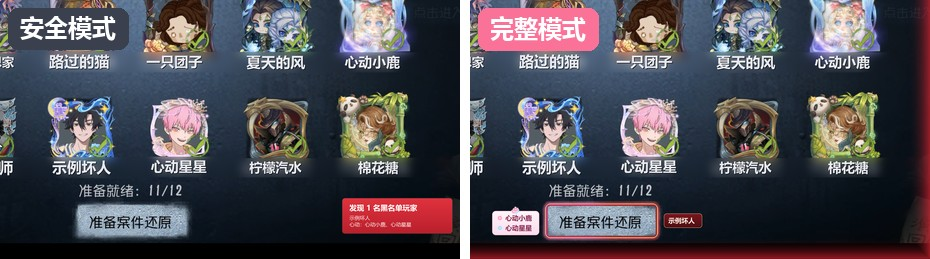
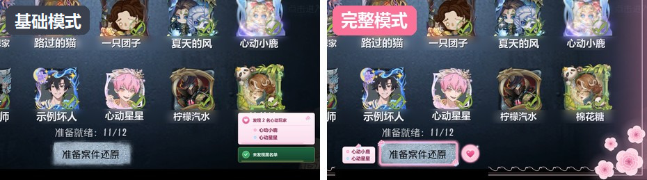

# 模仿者小工具

Version 1.0.0 · Windows desktop app for the 第五人格 模仿者 mode lobby.

When you sit in the **推演成功** / **模仿者狂欢（12人狂欢）** lobby, press a hotkey (or let it check by itself). The app copies
the screen, reads the twelve names under the character cards on your own PC, and tells you when one of them is on
your blacklist or is one of your 嘉宾.

It does not click **准备案件还原**, does not read game memory, does not send keys into the game, and sends no player
names anywhere.





## Features

- **黑名单** - check the lobby with a hotkey (default Alt+1). Names are read locally with PaddleOCR; the list, backups
  and logs stay in your own app data folder.
- **基础模式 / 完整模式** - a note in the bottom-right corner, or marks drawn right on the game screen.
- **自动检查** - checks by itself when the lobby appears (完整模式 only).
- **嘉宾 and 组合** - people you want to play with again; a lobby with them plays a 心动 scene (场景) with music, and
  several 嘉宾 can be grouped as a 组合. Scenes, tunes and hotkeys are set in 场景管理.
- **直播模式** - a separate stream window (「模仿者小工具·直播画面」) for 直播姬 window capture: viewers see 嘉宾 but
  never the blacklist.
- **Share a list** - 复制名单 on the 黑名单 page, then 批量导入 on a friend's copy.
- **记录** - every check's result.
- **声音** - 全局声音 (播放 / 静音) in 设置 for every sound; each 场景's own 音量 in 场景管理.
- **环境测试 and 导出日志** - a full self-check with a report, and a log file (without player names) to send for help.
- **检查更新** - the app checks for a new version when it opens, downloads it, and restarts; list, records and
  settings are kept.

## Install (for friends)

1. Open the [latest release](https://github.com/853493541/I5-Black-List/releases/latest) and download
   `BlackListDetect-v1.0.0-full.zip`. If GitHub does not open, the release notes list two mirror links.
2. Right-click the zip, **Extract All**, and open the extracted folder. Do not run the exe from inside the zip and do
   not drag the exe out on its own.
3. Double-click **模仿者小工具.exe**. If Windows shows 「Windows 已保护你的电脑」, click 「更多信息」 then 「仍要运行」.
4. The first start checks the reading setup (a few seconds) and shows the 使用声明.

Nothing else needs to be installed; the folder carries its own Python and models. The `使用说明.txt` in the folder
explains the rest in Chinese.

## Update

- v0.4.0 or newer: just open the app. It finds the new version, downloads it and restarts by itself.
- Older copies, or no connection to GitHub: download `BlackListDetect-<version>-update.zip` from the release (or get it
  from a friend) and extract it over the old folder.

## For developers

Python 3.12, Windows for the live screen copy and global hotkey (elsewhere only pictures can be checked).

```bash
python -m venv .venv
.venv\Scripts\activate
python -m pip install paddlepaddle==3.2.0 -i https://www.paddlepaddle.org.cn/packages/stable/cpu/
python -m pip install -r requirements.txt
python -m blacklist_detect                                           # the window
python -m blacklist_detect check tests/fixtures/reference-lobby.png  # read one picture, no window
python -m pytest                                                     # tests (OCR tests skip without Paddle)
python -m ruff check .
```

- OCR weights are not in the repo; the first check downloads them (`python -m blacklist_detect download-models` does it
  ahead of time, `BLACKLIST_DETECT_MODEL_DIR` points at a local copy).
- Data folder: `%APPDATA%\BlackListDetect` (list, settings, daily backups, logs).
- Release: `python build/build_launcher.py`, then `python build/make_release.py` builds the full and update zips from
  `dist\黑名单检测`; `python build/release.py` signs `version.json`, which the updater reads from the latest GitHub
  release. `python build/install_local.py` installs the newest code on this PC.
- CI (`.github/workflows/tests.yml`) runs the tests and ruff on Windows on every push.
- Old development notes and handoffs are in `docs/dev/`.

## Credits / third-party content

This is a non-commercial fan project made for fun among friends. It is not affiliated with or endorsed by NetEase.

- 第五人格, its icons, game screens and the game sound recordings used for some effects belong to NetEase. The app icon
  is the 模仿者 「导演」 icon (source: BWiki 第五人格WIKI).
- The little birds in 竖琴清风 are cut from fan art by the Weibo artist @子沐子_.
- All third-party content stays the property of its owners. If you own something here and want it removed, open an
  issue.
